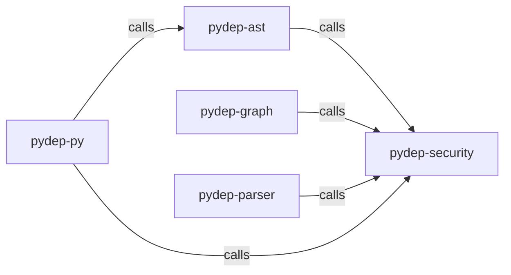

_Generated by CodeAtlas._

## Details

Owns 0 symbols across 0 file(s).

### pydep-ast

Owns 0 symbols across 1 file(s).

**Related Classes/Methods:** _None_

### pydep-graph

Owns 0 symbols across 1 file(s).

**Related Classes/Methods:** _None_

### pydep-parser

Owns 0 symbols across 1 file(s).

**Related Classes/Methods:** _None_

### pydep-py

Owns 0 symbols across 1 file(s).

**Related Classes/Methods:** _None_

### pydep-security

Owns 0 symbols across 1 file(s).

**Related Classes/Methods:** _None_
