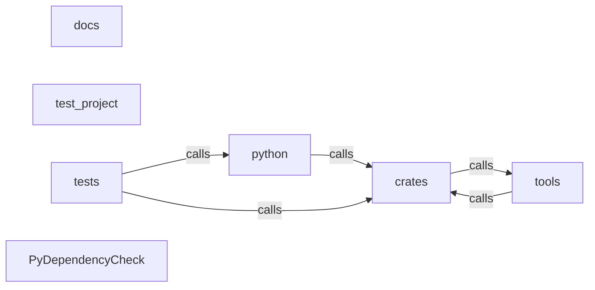

_Generated by CodeAtlas._

## Details

Architecture map of PyDependencyCheck.

### crates

Owns 0 symbols across 0 file(s).

**Related Classes/Methods:** _None_

### docs

Owns 0 symbols across 0 file(s).

**Related Classes/Methods:** _None_

### python

Owns 0 symbols across 0 file(s).

**Related Classes/Methods:** _None_

### test_project

Owns 0 symbols across 1 file(s).

**Related Classes/Methods:** _None_

### tests

Owns 227 symbols across 13 file(s).

**Related Classes/Methods:** _None_

**Source Files:**

- `tests/test_cli.py`
  - `tests.test_cli.TestExportCommand`
  - `tests.test_cli.TestExportCommand.test_export_cyclonedx_to_stdout_is_valid_json`
  - `tests.test_cli.TestExportCommand.test_export_output_survives_shell_redirection`
  - `tests.test_cli.TestExportCommand.test_export_sign_without_key_fails_cleanly`
  - `tests.test_cli.TestExportCommand.test_export_spdx_to_stdout_is_valid_json`
  - `tests.test_cli.TestExportCommand.test_export_to_file`
  - `tests.test_cli.TestGateCommand`
  - `tests.test_cli.TestGateCommand.test_gate_fails_when_min_health_not_met`
  - `tests.test_cli.TestGateCommand.test_gate_passes_for_healthy_project`
  - `tests.test_cli.TestHealthCommand`
  - `tests.test_cli.TestHealthCommand.test_health_offline_reports_real_computed_score`
  - `tests.test_cli.TestHealthCommand.test_health_reflects_dead_dependencies`
  - `tests.test_cli.TestLicensesCommand`
  - `tests.test_cli.TestLicensesCommand._mock_pypi_response`
  - `tests.test_cli.TestLicensesCommand.test_licenses_fail_on_restricted_exits_nonzero`
  - `tests.test_cli.TestLicensesCommand.test_licenses_project_license_compatibility_check`
  - `tests.test_cli.TestLicensesCommand.test_licenses_reports_compliance_summary`
  - `tests.test_cli.TestScanCommandStillWorks`
  - `tests.test_cli.TestScanCommandStillWorks.test_scan_html_report_escapes_malicious_names`
  - `tests.test_cli.TestTraceCommand`
  - `tests.test_cli.TestTraceCommand.test_trace_handles_non_git_directory_gracefully`
  - `tests.test_cli.TestTraceCommand.test_trace_reports_current_status_for_declared_package`
  - `tests.test_cli.TestTraceCommand.test_trace_reports_not_declared_for_unknown_package`
  - `tests.test_cli.project`
  - `tests.test_cli.runner`
- `tests/test_codeatlas_adapter.py`
  - `tests.test_codeatlas_adapter._run`
  - `tests.test_codeatlas_adapter.test_check_reports_the_embedded_engine_available`
  - `tests.test_codeatlas_adapter.test_diagnose_summarises_the_architecture_map`
  - `tests.test_codeatlas_adapter.test_explain_reports_an_unknown_node_as_an_error`
  - `tests.test_codeatlas_adapter.test_god_nodes_are_ranked_by_degree`
- `tests/test_git_integration.py`
  - `tests.test_git_integration._commit_file`
  - `tests.test_git_integration._make_two_hunk_repo`
  - `tests.test_git_integration.test_blame_line_number_first_hunk_still_correct`
  - `tests.test_git_integration.test_blame_line_number_is_absolute_across_hunks`
  - `tests.test_git_integration.test_blame_second_line_of_second_hunk`
- `tests/test_github_actions.py`
  - `tests.test_github_actions.TestGateExitCriteria`
  - `tests.test_github_actions.TestGateExitCriteria.test_fails_on_critical_vulnerabilities`
  - `tests.test_github_actions.TestGateExitCriteria.test_fails_on_low_health_score`
  - `tests.test_github_actions.TestGateExitCriteria.test_fails_when_dead_deps_exceed_threshold`
  - `tests.test_github_actions.TestGateExitCriteria.test_passes_clean_project`
  - `tests.test_github_actions.TestGitHubActionsReporterAnnotations`
  - `tests.test_github_actions.TestGitHubActionsReporterAnnotations.test_dead_dependencies_annotation`
  - `tests.test_github_actions.TestGitHubActionsReporterAnnotations.test_detects_ci_environment`
  - `tests.test_github_actions.TestGitHubActionsReporterAnnotations.test_detects_non_ci_environment`
  - `tests.test_github_actions.TestGitHubActionsReporterAnnotations.test_drift_annotation`
  - `tests.test_github_actions.TestGitHubActionsReporterAnnotations.test_health_score_annotation_severity`
  - `tests.test_github_actions.TestGitHubActionsReporterAnnotations.test_no_annotations_outside_ci`
  - `tests.test_github_actions.TestGitHubActionsReporterAnnotations.test_no_dead_dependencies_annotation_when_empty`
  - `tests.test_github_actions.TestGitHubActionsReporterAnnotations.test_no_drift_annotation_when_unchanged`
  - `tests.test_github_actions.TestGitHubActionsReporterAnnotations.test_vulnerability_annotation_uses_error_for_critical`
  - `tests.test_github_actions.TestGitHubActionsReporterAnnotations.test_vulnerability_annotation_uses_warning_for_medium`
  - `tests.test_github_actions.TestScoreToRating`
  - `tests.test_github_actions.TestScoreToRating.test_rating_boundaries`
  - `tests.test_github_actions.TestWorkflowGeneration`
  - `tests.test_github_actions.TestWorkflowGeneration.test_generated_workflow_is_valid_yaml`
  - `tests.test_github_actions.TestWorkflowGeneration.test_generated_workflow_references_real_commands`
  - `tests.test_github_actions.in_ci`
  - `tests.test_github_actions.not_in_ci`
- `tests/test_health.py`
  - `tests.test_health.TestHealthAnalyzer`
  - `tests.test_health.TestHealthAnalyzer.test_critical_vulnerability_tanks_score`
  - `tests.test_health.TestHealthAnalyzer.test_dead_dependencies_lower_quality_score`
  - `tests.test_health.TestHealthAnalyzer.test_empty_project_has_no_issues`
  - `tests.test_health.TestHealthAnalyzer.test_perfect_project_scores_high`
  - `tests.test_health.TestHealthAnalyzer.test_rating_thresholds`
  - `tests.test_health.TestHealthAnalyzer.test_recommendation_lists_actual_dead_package_names`
  - `tests.test_health.TestHealthAnalyzer.test_stale_packages_lower_maintenance_score`
  - `tests.test_health.TestPackageStalenessChecker`
  - `tests.test_health.TestPackageStalenessChecker.test_custom_threshold_respected`
  - `tests.test_health.TestPackageStalenessChecker.test_find_stale_packages_filters_correctly`
  - `tests.test_health.TestPackageStalenessChecker.test_find_stale_packages_filters_correctly.fake_get`
  - `tests.test_health.TestPackageStalenessChecker.test_old_release_is_stale`
  - `tests.test_health.TestPackageStalenessChecker.test_recent_release_is_not_stale`
  - `tests.test_health.TestPackageStalenessChecker.test_unknown_package_is_not_flagged_stale`
  - `tests.test_health._pypi_release_response`
- `tests/test_licenses.py`
  - `tests.test_licenses.TestAnalyzeProjectLicenses`
  - `tests.test_licenses.TestAnalyzeProjectLicenses.test_aggregates_risk_counts`
  - `tests.test_licenses.TestDeadDependencyDetector`
  - `tests.test_licenses.TestDeadDependencyDetector.test_finds_unused_declared_packages`
  - `tests.test_licenses.TestDeadDependencyDetector.test_no_dead_dependencies_when_all_used`
  - `tests.test_licenses.TestDeadDependencyDetector.test_normalizes_underscores_and_case`
  - `tests.test_licenses.TestLicenseAnalyzerClassification`
  - `tests.test_licenses.TestLicenseAnalyzerClassification.test_gpl_is_restricted`
  - `tests.test_licenses.TestLicenseAnalyzerClassification.test_lgpl_is_copyleft_not_restricted`
  - `tests.test_licenses.TestLicenseAnalyzerClassification.test_lowercase_bare_spdx_license_field_is_still_permissive`
  - `tests.test_licenses.TestLicenseAnalyzerClassification.test_mit_classifier_is_permissive`
  - `tests.test_licenses.TestLicenseAnalyzerClassification.test_network_failure_degrades_to_unknown_not_crash`
  - `tests.test_licenses.TestLicenseAnalyzerClassification.test_no_license_data_is_unknown`
  - `tests.test_licenses.TestLicenseAnalyzerClassification.test_results_are_cached`
  - `tests.test_licenses.TestLicenseCompatibility`
  - `tests.test_licenses.TestLicenseCompatibility.test_gpl_conflicts_with_permissive_project`
  - `tests.test_licenses.TestLicenseCompatibility.test_mismatched_copyleft_versions_conflict`
  - `tests.test_licenses.TestLicenseCompatibility.test_mit_dependency_always_compatible`
  - `tests.test_licenses.TestLicenseInfo`
  - `tests.test_licenses.TestLicenseInfo.test_str_representation`
  - `tests.test_licenses.TestLicenseInfo.test_str_with_no_licenses`
  - `tests.test_licenses._mock_pypi_response`
- `tests/test_remediate.py`
  - `tests.test_remediate.TestBuildRemediationPlanAndApply`
  - `tests.test_remediate.TestBuildRemediationPlanAndApply.test_full_plan_and_apply_writes_real_file`
  - `tests.test_remediate.TestBuildRemediationPlanAndApply.test_no_fixes_when_no_vulnerabilities`
  - `tests.test_remediate.TestBuildRemediationPlanAndApply.test_unsupported_file_type_produces_no_patch`
  - `tests.test_remediate.TestComputeFixes`
  - `tests.test_remediate.TestComputeFixes.test_ignores_vuln_for_unpinned_or_unknown_package`
  - `tests.test_remediate.TestComputeFixes.test_ignores_vuln_without_fix_available`
  - `tests.test_remediate.TestComputeFixes.test_matches_vulnerable_pinned_package`
  - `tests.test_remediate.TestComputeFixes.test_multiple_vulns_on_same_package_merge_and_take_highest_fix`
  - `tests.test_remediate.TestComputeFixes.test_name_matching_is_case_and_separator_insensitive`
  - `tests.test_remediate.TestComputeFixes.test_skips_when_already_at_fix_version`
  - `tests.test_remediate.TestPatchPyprojectContent`
  - `tests.test_remediate.TestPatchPyprojectContent.test_bumps_pin_inside_dependency_array`
  - `tests.test_remediate.TestPatchRequirementsContent`
  - `tests.test_remediate.TestPatchRequirementsContent.test_bumps_exact_pin`
  - `tests.test_remediate.TestPatchRequirementsContent.test_does_not_touch_prefix_matching_package`
  - `tests.test_remediate.TestPatchRequirementsContent.test_matches_dash_underscore_dot_interchangeably`
  - `tests.test_remediate.TestPatchRequirementsContent.test_preserves_extras_and_markers`
  - `tests.test_remediate.TestRemediateCliCommand`
  - `tests.test_remediate.TestRemediateCliCommand.runner`
  - `tests.test_remediate.TestRemediateCliCommand.test_apply_writes_real_file`
  - `tests.test_remediate.TestRemediateCliCommand.test_dry_run_prints_diff_and_does_not_write`
  - `tests.test_remediate.TestRemediateCliCommand.test_no_vulnerabilities_reports_clean`
  - `tests.test_remediate.TestRemediateCliCommand.test_pr_flow_creates_real_branch_and_commit`
  - `tests.test_remediate.TestRemediationRunner`
  - `tests.test_remediate.TestRemediationRunner.test_create_branch_and_commit_makes_a_real_commit`
  - `tests.test_remediate.TestRemediationRunner.test_create_pull_request_invokes_real_gh_binary`
  - `tests.test_remediate.TestRemediationRunner.test_create_pull_request_returns_none_when_gh_fails`
  - `tests.test_remediate.TestRemediationRunner.test_create_pull_request_returns_none_without_gh_cli`
  - `tests.test_remediate.TestRemediationRunner.test_non_git_directory_raises`
  - `tests.test_remediate.TestRemediationRunner.test_push_branch_missing_remote_raises`
  - `tests.test_remediate.TestRemediationRunner.test_push_branch_to_real_local_bare_remote`
  - `tests.test_remediate.TestRemediationRunner.test_refuses_dirty_working_tree`
  - `tests.test_remediate.TestRemediationRunner.test_refuses_existing_branch_name`
  - `tests.test_remediate._dep`
  - `tests.test_remediate._vuln`
  - `tests.test_remediate.git_project`
- `tests/test_reporters.py`
  - `tests.test_reporters.TestCycloneDxReporter`
  - `tests.test_reporters.TestCycloneDxReporter.test_generates_valid_cyclonedx_json`
  - `tests.test_reporters.TestEscapeHelper`
  - `tests.test_reporters.TestEscapeHelper.test_escapes_quotes_used_for_attribute_breakout`
  - `tests.test_reporters.TestEscapeHelper.test_escapes_script_tags`
  - `tests.test_reporters.TestEscapeHelper.test_none_becomes_empty_string`
  - `tests.test_reporters.TestEscapeHelper.test_passes_through_safe_text`
  - `tests.test_reporters.TestHtmlReporterBasics`
  - `tests.test_reporters.TestHtmlReporterBasics.test_empty_dependencies_produces_valid_shell`
  - `tests.test_reporters.TestHtmlReporterBasics.test_summary_counts`
  - `tests.test_reporters.TestHtmlReporterXSS`
  - `tests.test_reporters.TestHtmlReporterXSS._malicious_deps`
  - `tests.test_reporters.TestHtmlReporterXSS.test_ampersand_in_metadata_is_escaped`
  - `tests.test_reporters.TestHtmlReporterXSS.test_benign_dependency_still_renders_normally`
  - `tests.test_reporters.TestHtmlReporterXSS.test_malicious_package_name_is_neutralized`
  - `tests.test_reporters.TestHtmlReporterXSS.test_malicious_source_cannot_inject_svg_handler`
  - `tests.test_reporters.TestHtmlReporterXSS.test_malicious_version_cannot_break_out_of_attribute`
  - `tests.test_reporters.TestHtmlReporterXSS.test_output_is_still_well_formed_around_escaped_payload`
  - `tests.test_reporters.TestJsonReporter`
  - `tests.test_reporters.TestJsonReporter.test_generates_valid_json_with_summary`
  - `tests.test_reporters.TestMarkdownReporter`
  - `tests.test_reporters.TestMarkdownReporter.test_does_not_html_escape_markdown_output`
  - `tests.test_reporters.TestMarkdownReporter.test_generates_table_rows`
- `tests/test_sbom.py`
  - `tests.test_sbom.TestIntegrityHash`
  - `tests.test_sbom.TestIntegrityHash.test_hash_changes_with_content`
  - `tests.test_sbom.TestIntegrityHash.test_hash_is_deterministic`
  - `tests.test_sbom.TestSBOMGeneratorCycloneDx`
  - `tests.test_sbom.TestSBOMGeneratorCycloneDx.test_component_purl_and_scope`
  - `tests.test_sbom.TestSBOMGeneratorCycloneDx.test_generates_valid_cyclonedx_structure`
  - `tests.test_sbom.TestSBOMGeneratorCycloneDx.test_output_is_json_serializable`
  - `tests.test_sbom.TestSBOMGeneratorCycloneDx.test_tool_version_matches_package_version`
  - `tests.test_sbom.TestSBOMGeneratorSPDX`
  - `tests.test_sbom.TestSBOMGeneratorSPDX.test_generates_valid_spdx_structure`
  - `tests.test_sbom.TestSBOMGeneratorSPDX.test_relationships_describe_and_depend`
  - `tests.test_sbom.TestSBOMSigning`
  - `tests.test_sbom.TestSBOMSigning.test_sign_and_verify_round_trip`
  - `tests.test_sbom.TestSBOMSigning.test_sign_without_key_returns_sbom_unmodified`
  - `tests.test_sbom.TestSBOMSigning.test_verify_fails_on_tampered_sbom`
  - `tests.test_sbom.TestSBOMSigning.test_verify_without_signatures_returns_false`
  - `tests.test_sbom.rsa_keypair`
- `tests/test_scanner.py`
  - `tests.test_scanner.TestDependencyGraph`
  - `tests.test_scanner.TestDependencyGraph.test_add_nodes`
  - `tests.test_scanner.TestDependencyGraph.test_detect_cycles`
  - `tests.test_scanner.TestDependencyGraph.test_no_cycles_in_dag`
  - `tests.test_scanner.TestDependencyGraph.test_transitive_closure`
  - `tests.test_scanner.TestDependencyScanner`
  - `tests.test_scanner.TestDependencyScanner.test_find_dead_dependencies_no_rust_backend`
  - `tests.test_scanner.TestDependencyScanner.test_scan_dedupes_package_declared_in_multiple_files`
  - `tests.test_scanner.TestDependencyScanner.test_scan_empty_directory`
  - `tests.test_scanner.TestDependencyScanner.test_scan_excludes_nested_independent_project`
  - `tests.test_scanner.TestDependencyScanner.test_scan_ignores_venv_directory`
  - `tests.test_scanner.TestDependencyScanner.test_scan_pyproject_toml`
  - `tests.test_scanner.TestDependencyScanner.test_scan_requirements_txt`
  - `tests.test_scanner.TestDependencyScanner.test_scan_requirements_with_extras_and_range`
  - `tests.test_scanner.TestDependencyScanner.test_scan_requirements_with_non_equals_operators`
  - `tests.test_scanner.TestScanResult`
  - `tests.test_scanner.TestScanResult.test_to_dict_reflects_counts`
- `tests/test_storage.py`
  - `tests.test_storage.TestBaselineAndDrift`
  - `tests.test_storage.TestBaselineAndDrift.test_compute_drift_detects_added_and_removed`
  - `tests.test_storage.TestBaselineAndDrift.test_compute_drift_detects_upgrade`
  - `tests.test_storage.TestBaselineAndDrift.test_no_drift_when_unchanged`
  - `tests.test_storage.TestBaselineAndDrift.test_set_and_get_baseline`
  - `tests.test_storage.TestBaselineAndDrift.test_set_baseline_without_snapshot_fails_gracefully`
  - `tests.test_storage.TestSnapshotSaveAndRetrieve`
  - `tests.test_storage.TestSnapshotSaveAndRetrieve.test_get_latest_snapshot_returns_none_when_empty`
  - `tests.test_storage.TestSnapshotSaveAndRetrieve.test_identical_back_to_back_snapshots_both_save`
  - `tests.test_storage.TestSnapshotSaveAndRetrieve.test_save_and_get_latest_snapshot`
  - `tests.test_storage.TestSnapshotSaveAndRetrieve.test_snapshot_history_orders_newest_first`
  - `tests.test_storage.TestSnapshotStorageInitialization`
  - `tests.test_storage.TestSnapshotStorageInitialization.test_creates_expected_tables`
  - `tests.test_storage.TestSnapshotStorageInitialization.test_init_db_does_not_raise`
  - `tests.test_storage.TestVersionComparison`
  - `tests.test_storage.TestVersionComparison.test_invalid_version_does_not_raise`
  - `tests.test_storage.TestVersionComparison.test_version_greater`
- `tests/test_telemetry.py`
  - `tests.test_telemetry.TestConsoleExportEndToEnd`
  - `tests.test_telemetry.TestConsoleExportEndToEnd.test_prometheus_missing_falls_back_to_console_tracing`
  - `tests.test_telemetry.TestConsoleExportEndToEnd.test_record_scan_metric_produces_real_console_metrics_on_shutdown`
  - `tests.test_telemetry.TestConsoleExportEndToEnd.test_trace_scan_emits_real_span_to_stdout`
  - `tests.test_telemetry.TestConsoleExportEndToEnd.test_trace_scan_records_error_status_on_exception`
  - `tests.test_telemetry.TestTelemetryConfig`
  - `tests.test_telemetry.TestTelemetryConfig.test_disabled_by_default`
  - `tests.test_telemetry.TestTelemetryConfig.test_stdout_is_aliased_to_console`
  - `tests.test_telemetry.TestTelemetryManagerMetrics`
  - `tests.test_telemetry.TestTelemetryManagerMetrics.test_disabled_manager_metrics_are_noop`
  - `tests.test_telemetry.TestTelemetryManagerMetrics.test_record_scan_metric_does_not_raise`
  - `tests.test_telemetry.TestTelemetryManagerMetrics.test_record_vulnerability_metric_does_not_raise`
  - `tests.test_telemetry.TestTelemetryManagerTracing`
  - `tests.test_telemetry.TestTelemetryManagerTracing.test_disabled_manager_has_no_tracer`
  - `tests.test_telemetry.TestTelemetryManagerTracing.test_disabled_trace_scan_is_a_noop`
  - `tests.test_telemetry.TestTelemetryManagerTracing.test_enabled_manager_creates_real_tracer`
  - `tests.test_telemetry._first_json_object`
  - `tests.test_telemetry._run_in_subprocess`
- `tests/test_version.py`
  - `tests.test_version.test_dunder_license_is_apache_2_0`
  - `tests.test_version.test_dunder_version_matches_installed_metadata`

### tools

Owns 0 symbols across 0 file(s).

**Related Classes/Methods:** _None_

### PyDependencyCheck

Owns 0 symbols across 13 file(s).

**Related Classes/Methods:** _None_
