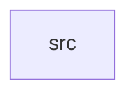

_Generated by CodeAtlas._

## Details

Owns 0 symbols across 1 file(s).

### src

Owns 33 symbols across 7 file(s).

**Related Classes/Methods:** _None_

**Source Files:**

- `crates/pydep-parser/src/constraint.rs`
  - `crates.pydep-parser.src.constraint.parse_constraints`
  - `crates.pydep-parser.src.constraint.parse_constraints_file`
  - `crates.pydep-parser.src.constraint.tests.comments_and_directives_are_skipped`
  - `crates.pydep-parser.src.constraint.tests.exact_pin_keeps_its_version_constraint`
  - `crates.pydep-parser.src.constraint.tests.range_constraint_keeps_clean_name_and_version`
- `crates/pydep-parser/src/errors.rs`
  - `crates.pydep-parser.src.errors.ParserError`
- `crates/pydep-parser/src/lib.rs`
  - `crates.pydep-parser.src.lib.parse_file`
  - `crates.pydep-parser.src.lib.tests.test_parse_file_unknown_type_errs`
  - `crates.pydep-parser.src.lib.tests.test_parse_requirements_basic`
- `crates/pydep-parser/src/models.rs`
  - `crates.pydep-parser.src.models.Dependency`
  - `crates.pydep-parser.src.models.Dependency.fmt`
  - `crates.pydep-parser.src.models.DependencySource`
  - `crates.pydep-parser.src.models.DependencySource.fmt`
  - `crates.pydep-parser.src.models.VersionConstraint`
  - `crates.pydep-parser.src.models.VersionConstraint.fmt`
  - `crates.pydep-parser.src.models.VersionSpecifier`
- `crates/pydep-parser/src/pyproject.rs`
  - `crates.pydep-parser.src.pyproject.parse_pyproject`
  - `crates.pydep-parser.src.pyproject.tests.test_parse_pep621_pyproject`
  - `crates.pydep-parser.src.pyproject.tests.test_parse_poetry_pyproject`
  - `crates.pydep-parser.src.pyproject.tests.write_temp_pyproject`
- `crates/pydep-parser/src/requirements.rs`
  - `crates.pydep-parser.src.requirements.normalize_package_name`
  - `crates.pydep-parser.src.requirements.parse_name_and_version`
  - `crates.pydep-parser.src.requirements.parse_pep508_requirement`
  - `crates.pydep-parser.src.requirements.parse_requirements`
  - `crates.pydep-parser.src.requirements.parse_requirements_file`
  - `crates.pydep-parser.src.requirements.parse_version_constraint`
  - `crates.pydep-parser.src.requirements.tests.test_normalize_package_name`
  - `crates.pydep-parser.src.requirements.tests.test_parse_complex_version_constraint`
  - `crates.pydep-parser.src.requirements.tests.test_parse_requirement_with_extras`
  - `crates.pydep-parser.src.requirements.tests.test_parse_requirement_with_markers`
  - `crates.pydep-parser.src.requirements.tests.test_parse_simple_requirement`
- `crates/pydep-parser/src/setup.rs`
  - `crates.pydep-parser.src.setup.parse_setup_cfg`
  - `crates.pydep-parser.src.setup.parse_setup_py`
