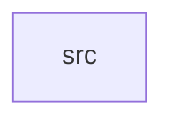

_Generated by CodeAtlas._

## Details

Owns 0 symbols across 1 file(s).

### src

Owns 34 symbols across 5 file(s).

**Related Classes/Methods:** _None_

**Source Files:**

- `crates/pydep-py/src/ast.rs`
  - `crates.pydep-py.src.ast.collect_py_files`
  - `crates.pydep-py.src.ast.find_dead_packages`
  - `crates.pydep-py.src.ast.register_ast`
  - `crates.pydep-py.src.ast.scan_imports`
- `crates/pydep-py/src/graph.rs`
  - `crates.pydep-py.src.graph.DependencyGraph`
  - `crates.pydep-py.src.graph.DependencyGraph.add_edge`
  - `crates.pydep-py.src.graph.DependencyGraph.add_node`
  - `crates.pydep-py.src.graph.DependencyGraph.edge_count`
  - `crates.pydep-py.src.graph.DependencyGraph.edges`
  - `crates.pydep-py.src.graph.DependencyGraph.find_cycles`
  - `crates.pydep-py.src.graph.DependencyGraph.get_all_dependencies`
  - `crates.pydep-py.src.graph.DependencyGraph.has_cycles`
  - `crates.pydep-py.src.graph.DependencyGraph.new`
  - `crates.pydep-py.src.graph.DependencyGraph.node_count`
  - `crates.pydep-py.src.graph.DependencyGraph.nodes`
  - `crates.pydep-py.src.graph.register_graph`
- `crates/pydep-py/src/lib.rs`
  - `crates.pydep-py.src.lib._pydependencycheck`
- `crates/pydep-py/src/parser.rs`
  - `crates.pydep-py.src.parser.Dependency`
  - `crates.pydep-py.src.parser.Dependency.__repr__`
  - `crates.pydep-py.src.parser.Dependency.new`
  - `crates.pydep-py.src.parser.convert_dependency`
  - `crates.pydep-py.src.parser.parse_file`
  - `crates.pydep-py.src.parser.parse_pyproject_toml`
  - `crates.pydep-py.src.parser.parse_requirements_file`
  - `crates.pydep-py.src.parser.register_parser`
- `crates/pydep-py/src/security.rs`
  - `crates.pydep-py.src.security.PySeverity`
  - `crates.pydep-py.src.security.PySeverity.from`
  - `crates.pydep-py.src.security.Vulnerability`
  - `crates.pydep-py.src.security.Vulnerability.__repr__`
  - `crates.pydep-py.src.security.Vulnerability.from`
  - `crates.pydep-py.src.security.register_security`
  - `crates.pydep-py.src.security.scan_package`
  - `crates.pydep-py.src.security.scan_vulnerabilities`
  - `crates.pydep-py.src.security.severity_str`
