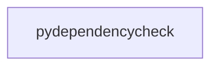

_Generated by CodeAtlas._

## Details

Owns 0 symbols across 0 file(s).

### pydependencycheck

Owns 187 symbols across 14 file(s).

**Related Classes/Methods:** _None_

**Source Files:**

- `python/pydependencycheck/cli.py`
  - `python.pydependencycheck.cli._compute_health`
  - `python.pydependencycheck.cli._format_table_report`
  - `python.pydependencycheck.cli.cli`
  - `python.pydependencycheck.cli.drift`
  - `python.pydependencycheck.cli.export`
  - `python.pydependencycheck.cli.gate`
  - `python.pydependencycheck.cli.health`
  - `python.pydependencycheck.cli.history`
  - `python.pydependencycheck.cli.licenses_cmd`
  - `python.pydependencycheck.cli.list`
  - `python.pydependencycheck.cli.main`
  - `python.pydependencycheck.cli.remediate`
  - `python.pydependencycheck.cli.scan`
  - `python.pydependencycheck.cli.snapshot`
  - `python.pydependencycheck.cli.trace`
  - `python.pydependencycheck.cli.why`
- `python/pydependencycheck/dashboard.py`
  - `python.pydependencycheck.dashboard.CLIDashboard`
  - `python.pydependencycheck.dashboard.CLIDashboard.__init__`
  - `python.pydependencycheck.dashboard.CLIDashboard._get_factor_rating`
  - `python.pydependencycheck.dashboard.CLIDashboard._score_to_bar`
  - `python.pydependencycheck.dashboard.CLIDashboard._score_to_rich_text`
  - `python.pydependencycheck.dashboard.CLIDashboard.show_drift_report`
  - `python.pydependencycheck.dashboard.CLIDashboard.show_health_details`
  - `python.pydependencycheck.dashboard.CLIDashboard.show_live_monitor`
  - `python.pydependencycheck.dashboard.CLIDashboard.show_summary`
  - `python.pydependencycheck.dashboard.CLIDashboard.show_timeline`
- `python/pydependencycheck/git_integration.py`
  - `python.pydependencycheck.git_integration.BlameInfo`
  - `python.pydependencycheck.git_integration.BlameInfo.__init__`
  - `python.pydependencycheck.git_integration.GitIntegration`
  - `python.pydependencycheck.git_integration.GitIntegration.__init__`
  - `python.pydependencycheck.git_integration.GitIntegration._extract_version`
  - `python.pydependencycheck.git_integration.GitIntegration._is_package_in_content`
  - `python.pydependencycheck.git_integration.GitIntegration._is_package_in_line`
  - `python.pydependencycheck.git_integration.GitIntegration._parse_content`
  - `python.pydependencycheck.git_integration.GitIntegration.get_blame`
  - `python.pydependencycheck.git_integration.GitIntegration.get_commit_deps`
  - `python.pydependencycheck.git_integration.GitIntegration.get_history`
  - `python.pydependencycheck.git_integration.GitIntegration.is_git_repo`
- `python/pydependencycheck/github_actions.py`
  - `python.pydependencycheck.github_actions.GitHubActionsReporter`
  - `python.pydependencycheck.github_actions.GitHubActionsReporter.__init__`
  - `python.pydependencycheck.github_actions.GitHubActionsReporter._output_annotation`
  - `python.pydependencycheck.github_actions.GitHubActionsReporter._score_to_rating`
  - `python.pydependencycheck.github_actions.GitHubActionsReporter.fail_if_criteria_met`
  - `python.pydependencycheck.github_actions.GitHubActionsReporter.report_dead_dependencies`
  - `python.pydependencycheck.github_actions.GitHubActionsReporter.report_drift`
  - `python.pydependencycheck.github_actions.GitHubActionsReporter.report_health_score`
  - `python.pydependencycheck.github_actions.GitHubActionsReporter.report_vulnerabilities`
  - `python.pydependencycheck.github_actions.create_github_actions_workflow`
- `python/pydependencycheck/health.py`
  - `python.pydependencycheck.health.HealthAnalyzer`
  - `python.pydependencycheck.health.HealthAnalyzer.__init__`
  - `python.pydependencycheck.health.HealthAnalyzer._identify_issues`
  - `python.pydependencycheck.health.HealthAnalyzer._make_recommendations`
  - `python.pydependencycheck.health.HealthAnalyzer._score_complexity`
  - `python.pydependencycheck.health.HealthAnalyzer._score_maintenance`
  - `python.pydependencycheck.health.HealthAnalyzer._score_quality`
  - `python.pydependencycheck.health.HealthAnalyzer._score_to_rating`
  - `python.pydependencycheck.health.HealthAnalyzer._score_vulnerabilities`
  - `python.pydependencycheck.health.HealthAnalyzer.compute_health_score`
  - `python.pydependencycheck.health.HealthScore`
  - `python.pydependencycheck.health.HealthScore.__post_init__`
  - `python.pydependencycheck.health.PackageStalenessChecker`
  - `python.pydependencycheck.health.PackageStalenessChecker.__init__`
  - `python.pydependencycheck.health.PackageStalenessChecker.find_stale_packages`
  - `python.pydependencycheck.health.PackageStalenessChecker.is_stale`
  - `python.pydependencycheck.health.PackageStalenessChecker.last_release_date`
- `python/pydependencycheck/licenses.py`
  - `python.pydependencycheck.licenses.DeadDependencyDetector`
  - `python.pydependencycheck.licenses.DeadDependencyDetector.__init__`
  - `python.pydependencycheck.licenses.DeadDependencyDetector.find_dead_dependencies`
  - `python.pydependencycheck.licenses.LicenseAnalyzer`
  - `python.pydependencycheck.licenses.LicenseAnalyzer.__init__`
  - `python.pydependencycheck.licenses.LicenseAnalyzer._classify_risk`
  - `python.pydependencycheck.licenses.LicenseAnalyzer._fetch_from_pypi`
  - `python.pydependencycheck.licenses.LicenseAnalyzer._is_spdx_license`
  - `python.pydependencycheck.licenses.LicenseAnalyzer._normalize_license`
  - `python.pydependencycheck.licenses.LicenseAnalyzer.analyze_package`
  - `python.pydependencycheck.licenses.LicenseAnalyzer.analyze_project_licenses`
  - `python.pydependencycheck.licenses.LicenseAnalyzer.check_compatibility`
  - `python.pydependencycheck.licenses.LicenseInfo`
  - `python.pydependencycheck.licenses.LicenseInfo.__post_init__`
  - `python.pydependencycheck.licenses.LicenseInfo.__str__`
- `python/pydependencycheck/remediate.py`
  - `python.pydependencycheck.remediate.PackageFix`
  - `python.pydependencycheck.remediate.RemediationError`
  - `python.pydependencycheck.remediate.RemediationPlan`
  - `python.pydependencycheck.remediate.RemediationPlan.diff`
  - `python.pydependencycheck.remediate.RemediationPlan.has_fixes`
  - `python.pydependencycheck.remediate.RemediationRunner`
  - `python.pydependencycheck.remediate.RemediationRunner.__init__`
  - `python.pydependencycheck.remediate.RemediationRunner._commit_message`
  - `python.pydependencycheck.remediate.RemediationRunner.create_branch_and_commit`
  - `python.pydependencycheck.remediate.RemediationRunner.create_pull_request`
  - `python.pydependencycheck.remediate.RemediationRunner.push_branch`
  - `python.pydependencycheck.remediate._normalize`
  - `python.pydependencycheck.remediate._patch_file`
  - `python.pydependencycheck.remediate._requirements_pin_pattern`
  - `python.pydependencycheck.remediate._toml_pin_pattern`
  - `python.pydependencycheck.remediate._version_key`
  - `python.pydependencycheck.remediate.apply_plan`
  - `python.pydependencycheck.remediate.build_remediation_plan`
  - `python.pydependencycheck.remediate.compute_fixes`
  - `python.pydependencycheck.remediate.patch_pyproject_content`
  - `python.pydependencycheck.remediate.patch_requirements_content`
- `python/pydependencycheck/reporters.py`
  - `python.pydependencycheck.reporters.CycloneDxReporter`
  - `python.pydependencycheck.reporters.CycloneDxReporter.generate`
  - `python.pydependencycheck.reporters.HtmlReporter`
  - `python.pydependencycheck.reporters.HtmlReporter.generate`
  - `python.pydependencycheck.reporters.JsonReporter`
  - `python.pydependencycheck.reporters.JsonReporter.generate`
  - `python.pydependencycheck.reporters.MarkdownReporter`
  - `python.pydependencycheck.reporters.MarkdownReporter.generate`
  - `python.pydependencycheck.reporters.Reporter`
  - `python.pydependencycheck.reporters.Reporter.generate`
  - `python.pydependencycheck.reporters.escape`
- `python/pydependencycheck/sbom.py`
  - `python.pydependencycheck.sbom.SBOMGenerator`
  - `python.pydependencycheck.sbom.SBOMGenerator.compute_integrity_hash`
  - `python.pydependencycheck.sbom.SBOMGenerator.generate_cyclonedx`
  - `python.pydependencycheck.sbom.SBOMGenerator.generate_spdx`
  - `python.pydependencycheck.sbom.SBOMSigner`
  - `python.pydependencycheck.sbom.SBOMSigner.__init__`
  - `python.pydependencycheck.sbom.SBOMSigner._load_keys`
  - `python.pydependencycheck.sbom.SBOMSigner.generate_keys`
  - `python.pydependencycheck.sbom.SBOMSigner.sign_sbom`
  - `python.pydependencycheck.sbom.SBOMSigner.verify_sbom`
- `python/pydependencycheck/scanner.py`
  - `python.pydependencycheck.scanner.DependencyScanner`
  - `python.pydependencycheck.scanner.DependencyScanner.__init__`
  - `python.pydependencycheck.scanner.DependencyScanner._build_graph`
  - `python.pydependencycheck.scanner.DependencyScanner._find_nested_project_dirs`
  - `python.pydependencycheck.scanner.DependencyScanner._is_ignored`
  - `python.pydependencycheck.scanner.DependencyScanner._parse_file`
  - `python.pydependencycheck.scanner.DependencyScanner._parse_file_rust`
  - `python.pydependencycheck.scanner.DependencyScanner._parse_pep508`
  - `python.pydependencycheck.scanner.DependencyScanner._parse_pyproject_toml`
  - `python.pydependencycheck.scanner.DependencyScanner._parse_requirements_txt`
  - `python.pydependencycheck.scanner.DependencyScanner._parse_setup_file`
  - `python.pydependencycheck.scanner.DependencyScanner.analyze_usage`
  - `python.pydependencycheck.scanner.DependencyScanner.check_vulnerabilities`
  - `python.pydependencycheck.scanner.DependencyScanner.find_dead_dependencies`
  - `python.pydependencycheck.scanner.DependencyScanner.find_dependency_files`
  - `python.pydependencycheck.scanner.DependencyScanner.find_dependency_files._in_nested_project`
  - `python.pydependencycheck.scanner.DependencyScanner.parse_dependencies`
  - `python.pydependencycheck.scanner.DependencyScanner.scan`
  - `python.pydependencycheck.scanner.ScanResult`
  - `python.pydependencycheck.scanner.ScanResult.__init__`
  - `python.pydependencycheck.scanner.ScanResult.to_dict`
  - `python.pydependencycheck.scanner.exact_pin_version`
- `python/pydependencycheck/storage.py`
  - `python.pydependencycheck.storage.DriftSnapshot`
  - `python.pydependencycheck.storage.DriftSnapshot.__init__`
  - `python.pydependencycheck.storage.SnapshotStorage`
  - `python.pydependencycheck.storage.SnapshotStorage.__init__`
  - `python.pydependencycheck.storage.SnapshotStorage._compute_drift`
  - `python.pydependencycheck.storage.SnapshotStorage._compute_graph_hash`
  - `python.pydependencycheck.storage.SnapshotStorage._init_db`
  - `python.pydependencycheck.storage.SnapshotStorage._version_greater`
  - `python.pydependencycheck.storage.SnapshotStorage.cleanup_old_snapshots`
  - `python.pydependencycheck.storage.SnapshotStorage.detect_drift`
  - `python.pydependencycheck.storage.SnapshotStorage.get_baseline`
  - `python.pydependencycheck.storage.SnapshotStorage.get_latest_snapshot`
  - `python.pydependencycheck.storage.SnapshotStorage.get_snapshot_history`
  - `python.pydependencycheck.storage.SnapshotStorage.save_snapshot`
  - `python.pydependencycheck.storage.SnapshotStorage.set_baseline`
- `python/pydependencycheck/telemetry.py`
  - `python.pydependencycheck.telemetry.TelemetryConfig`
  - `python.pydependencycheck.telemetry.TelemetryConfig.__init__`
  - `python.pydependencycheck.telemetry.TelemetryManager`
  - `python.pydependencycheck.telemetry.TelemetryManager.__init__`
  - `python.pydependencycheck.telemetry.TelemetryManager._setup_metrics`
  - `python.pydependencycheck.telemetry.TelemetryManager._setup_tracing`
  - `python.pydependencycheck.telemetry.TelemetryManager.record_performance_metric`
  - `python.pydependencycheck.telemetry.TelemetryManager.record_scan_metric`
  - `python.pydependencycheck.telemetry.TelemetryManager.record_vulnerability_metric`
  - `python.pydependencycheck.telemetry.TelemetryManager.shutdown`
  - `python.pydependencycheck.telemetry.TelemetryManager.trace_git_blame`
  - `python.pydependencycheck.telemetry.TelemetryManager.trace_scan`
  - `python.pydependencycheck.telemetry.TelemetryManager.trace_vulnerability_scan`
  - `python.pydependencycheck.telemetry.get_telemetry`
  - `python.pydependencycheck.telemetry.init_telemetry`
  - `python.pydependencycheck.telemetry.is_telemetry_enabled`
- `python/pydependencycheck/vulnerabilities.py`
  - `python.pydependencycheck.vulnerabilities.Vulnerability`
  - `python.pydependencycheck.vulnerabilities.Vulnerability.__post_init__`
  - `python.pydependencycheck.vulnerabilities.VulnerabilityAnalyzer`
  - `python.pydependencycheck.vulnerabilities.VulnerabilityAnalyzer.__init__`
  - `python.pydependencycheck.vulnerabilities.VulnerabilityAnalyzer._compute_risk_score`
  - `python.pydependencycheck.vulnerabilities.VulnerabilityAnalyzer._extract_severity`
  - `python.pydependencycheck.vulnerabilities.VulnerabilityAnalyzer._query_osv`
  - `python.pydependencycheck.vulnerabilities.VulnerabilityAnalyzer._score_to_rating`
  - `python.pydependencycheck.vulnerabilities.VulnerabilityAnalyzer.analyze_package`
  - `python.pydependencycheck.vulnerabilities.VulnerabilityAnalyzer.analyze_project`
  - `python.pydependencycheck.vulnerabilities.VulnerabilityReport`
  - `python.pydependencycheck.vulnerabilities.VulnerabilityReport.__post_init__`
